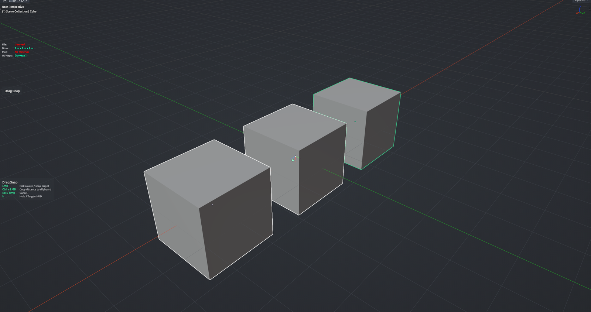

# Drag Snap

Point-to-point move for objects, without entering Edit Mode. Hover a mesh, click the point you want to move from, then click the point you want to land on — the whole selection is moved by that offset. Each click snaps to a vertex, a point on an edge, an edge middle or a face center, chosen by the modifier held at that click, so a vertex can land on an edge, a face center on a face center, and so on. Use it to butt kit pieces together precisely in Object Mode.

Every visible mesh is a snap target, including collection instances and the geometry their modifiers create (Mirror, Array, ...). A vertex or edge of a neighbouring object is found even when the object under the mouse is another one, as at the seam of two kit pieces; elements hidden behind other geometry are skipped.

**Hotkey:** <kbd>Ctrl</kbd>+<kbd>Alt</kbd>+<kbd>Shift</kbd>+<kbd>S</kbd> (Object Mode, 3D View)

## Controls
| Key | Action |
| --- | --- |
| Mouse move | Highlight the nearest snap point under the cursor |
| <kbd>LMB</kbd> (first click) | Pick the source point |
| <kbd>LMB</kbd> (second click) | Pick the target point and move the selection |
| No modifier | Snap to a vertex |
| <kbd>Shift</kbd> (held at a click) | Snap to the point of the edge under the cursor |
| <kbd>Alt</kbd> (held at a click) | Snap to the middle of the edge under the cursor |
| <kbd>Ctrl</kbd> (held at a click) | Snap to the center of the face under the cursor |
| <kbd>C</kbd> | Toggle Measure: the target click copies the source-to-target distance to the clipboard instead of moving |
| <kbd>MMB</kbd> / Wheel | Navigate the viewport |
| <kbd>Esc</kbd> / <kbd>RMB</kbd> | Cancel |
| <kbd>H</kbd> | Show / hide the help legend |

## Tips
- Click the same vertex twice to place the 3D cursor there instead of moving anything.
- The modifier is read at each click on its own: pick the source on an edge with <kbd>Shift</kbd> and the target as a plain vertex, for example.
- Non-mesh objects (curves, text) are not snap targets.
