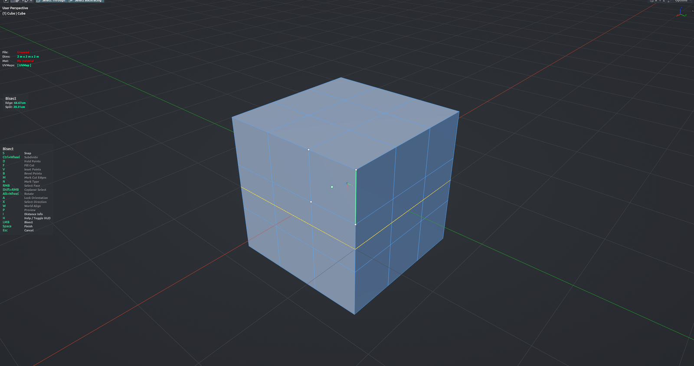

# Cursor Bisect

Cuts the mesh with a plane anchored to the 3D cursor and aligned to the face and edge under the mouse. Snap the cut to vertices, edge midpoints, regular subdivisions or a typed distance from an edge end, then click to cut — stay in the tool and keep cutting. The Selection Bounds snap source slices a whole selection into equal parts edge-to-edge, whatever its topology. Bevel mode drops two parallel cuts at once, Fill mode cuts at every snap point along the highlighted edge, and new edges can be marked as seam / sharp / crease / bevel weight. Edit Mesh mode.

**Hotkey:** Not bound by default — assign a key in *Preferences › iOps › Keymaps*, or run it from the iOps pie / operator search.

## Controls
| Key | Action |
| --- | --- |
| Move mouse | Pick the face and edge under the cursor, place the cut |
| <kbd>LMB</kbd> | Cut (stays in the tool) |
| <kbd>RMB</kbd> | Select / deselect the face under the cursor (only selected faces get cut) |
| <kbd>Shift</kbd>+<kbd>RMB</kbd> | Add / remove coplanar faces around the clicked face |
| <kbd>Ctrl</kbd>+<kbd>Wheel</kbd> | More / fewer snap subdivisions on the edge |
| <kbd>Alt</kbd>+<kbd>Wheel</kbd> | Rotate the cut plane in steps |
| <kbd>S</kbd> | Snapping on / off |
| <kbd>Shift</kbd>+<kbd>S</kbd> | Cycle snap source: Face Edge → Selection Bounds (see below) |
| <kbd>D</kbd> | Hold the current snap points |
| <kbd>A</kbd> | Lock the current orientation |
| <kbd>X</kbd> | Cycle which cursor axis is the cut normal: X → Y → Z (Z cuts in the plane of the face under the cursor; Inset, Bevel and Fill Cut are unavailable in Z) |
| <kbd>L</kbd> | Delimiter on / off: cut only the piece of mesh under the cursor |
| <kbd>Shift</kbd>+<kbd>L</kbd> | Cycle delimiter type: Mesh Island → Seam → Sharp → UV Island → Material → Normal |
| <kbd>W</kbd> | Cycle world-axis alignment (X → Y → Z) |
| <kbd>P</kbd> | Preview as a line or as a plane |
| <kbd>F</kbd> | Fill cut: cut at every snap point on the highlighted edge |
| <kbd>V</kbd> | Inset points: extra snap points at a fixed distance from the edge ends |
| <kbd>B</kbd> | Bevel mode: two parallel cuts |
| <kbd>0</kbd>–<kbd>9</kbd>, <kbd>.</kbd>, <kbd>Backspace</kbd>, <kbd>Enter</kbd> | Type the inset / bevel distance (while V or B is on) |
| <kbd>M</kbd> | Mark the new cut edges |
| <kbd>N</kbd> | Cycle mark type: Seam → Sharp → Crease → Bevel |
| <kbd>I</kbd> | Show distance info near the cursor |
| <kbd>Z</kbd> | Deselect all |
| <kbd>Ctrl</kbd>+<kbd>Z</kbd> | Undo the last cut |
| <kbd>MMB</kbd> / <kbd>Wheel</kbd> | Navigate the viewport |
| <kbd>H</kbd> | Show / hide the help legend |
| <kbd>Space</kbd> | Finish |
| <kbd>Esc</kbd> | Cancel |

## Options
- **Merge Doubles** — merge vertices left close together after the cut, using the merge distance from the preferences.

## Snap source
<kbd>Shift</kbd>+<kbd>S</kbd> picks where the snap points come from (the HUD header shows *Snap Source: Selection Bounds* while it is on):

- **Face Edge** (default) — the vertices, edge subdivisions and center of the face under the mouse; Fill Cut divides the highlighted edge.
- **Selection Bounds** — an oriented box around the faces the cut works on (the selected faces, or every visible face when nothing is selected, narrowed by the delimiter when it is on), across every mesh in Edit Mode, aligned to the current cut orientation. The box sides that run along the cut normal are divided into equal parts (<kbd>Ctrl</kbd>+<kbd>Wheel</kbd> sets how many; at least the midpoint), and those divisions are the snap points. Fill Cut (<kbd>F</kbd>) then cuts at every division, so the selection is sliced into equal parts from one side of the box to the other regardless of topology. Inset points (<kbd>V</kbd>) sit at the typed distance from both ends of those box sides and replace the midpoint, as on an edge. The box follows the orientation (<kbd>A</kbd>, <kbd>W</kbd>, <kbd>X</kbd>, <kbd>Alt</kbd>+<kbd>Wheel</kbd>), the selection and the delimiter; <kbd>D</kbd> freezes it with its points. Distance info shows the box side length (*Bounds*) and the cursor's distance to its nearer end (*Split*). Switching to Selection Bounds turns snapping on.

## Delimiter
With the delimiter on (<kbd>L</kbd>) the cut is confined to the piece of mesh under the mouse: starting from the hovered face, the tool walks across shared edges and stops at every edge that counts as a boundary for the chosen type. A face selection is still the ceiling: if faces are selected, the walk only runs inside the selection, and a hovered face outside it gives no cut. Only the object under the mouse is cut; other selected objects are left alone. The preview lines show exactly the faces the click will cut. Types: *Mesh Island* stops only where the mesh is disconnected, *Seam* / *Sharp* stop at edges marked seam or sharp, *UV Island* stops where the UVs tear across an edge, *Material* stops at a material change, and *Normal* stops where neighbouring faces meet at more than the *Delimit Angle* preference.

## Tips
- Deforming modifiers (Subdivision, Solidify, Array…) are switched off while the tool runs so you cut the base mesh; they come back on exit.
- Your snap / mark / preview settings are remembered for the next run.
