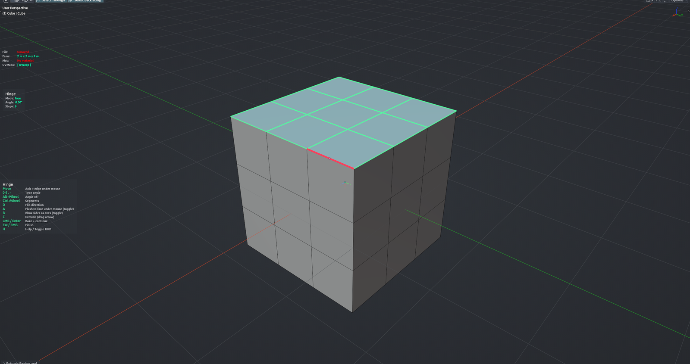

# Hinge

Rotates the selected faces (or edges) around the edge under the mouse, baking the sweep as segments — like folding a flap on a hinge. Click an edge to lock the hinge axis, set the angle (type it, Ctrl+Wheel for segments, or A to land flush on a face you point at), then click again (or press Space) to bake. Each bake keeps you going from the new position. Edit Mesh mode.

**Hotkey:** Not bound by default — assign a key in *Preferences › iOps › Keymaps*, or run it from the iOps pie / operator search. Also available: iOps Pie › Hinge.

## Controls
| Key | Action |
| --- | --- |
| Move mouse | Hinge axis = edge under the cursor |
| <kbd>0</kbd>–<kbd>9</kbd>, <kbd>.</kbd>, <kbd>-</kbd>, <kbd>Backspace</kbd> | Type the angle |
| <kbd>Alt</kbd>+<kbd>Wheel</kbd> | Angle ±5° |
| <kbd>Ctrl</kbd>+<kbd>Wheel</kbd> | Segments |
| <kbd>D</kbd> | Flip direction |
| <kbd>A</kbd> | Flush: rotate until coplanar with the face under the cursor (toggle) |
| <kbd>B</kbd> | Use the selection's bounding-box sides as axes (toggle) |
| <kbd>E</kbd> | Extrude the selection (drag the arrow), then continue hinging |
| <kbd>MMB</kbd> / <kbd>Wheel</kbd> | Navigate the viewport |
| <kbd>H</kbd> | Show / hide the help legend |
| <kbd>LMB</kbd> | Lock the hinge axis under the cursor (first click) |
| <kbd>LMB</kbd> / <kbd>Space</kbd> | Apply the hinge and keep going (second click) |
| <kbd>Q</kbd> | Lock / unlock the hinge axis |
| <kbd>Esc</kbd> / <kbd>RMB</kbd> | Cancel: release the axis lock, then finish (leaves Flush mode first if it is on) |

## HUD

The HUD lists the main options always. Every key works whether its row is shown or not. <kbd>H</kbd> opens the help: the full key list of the operator, collapsed until you press it. <kbd>/</kbd> hides the rows.

| Row | Shown |
| --- | --- |
| Mode, Angle (Type / Alt + Wheel), Segments (Ctrl + Wheel) | always |
| Axis Locked (Q) | while the axis is locked |
| Hinge Offset | while the hinge line is moved off the edge |
| Flush to Face (A) | while on |
| Bounding Box Sides (B) | while on |
| Bounding Box Space (S) | while Bounding Box Sides is on |

The header shows `Typing: ...` while you type an angle. <kbd>D</kbd>, <kbd>X</kbd>, <kbd>E</kbd> and the mouse buttons are actions and appear in the help only.

## Tips
- The preview is a ghost; the mesh only changes when you bake.
