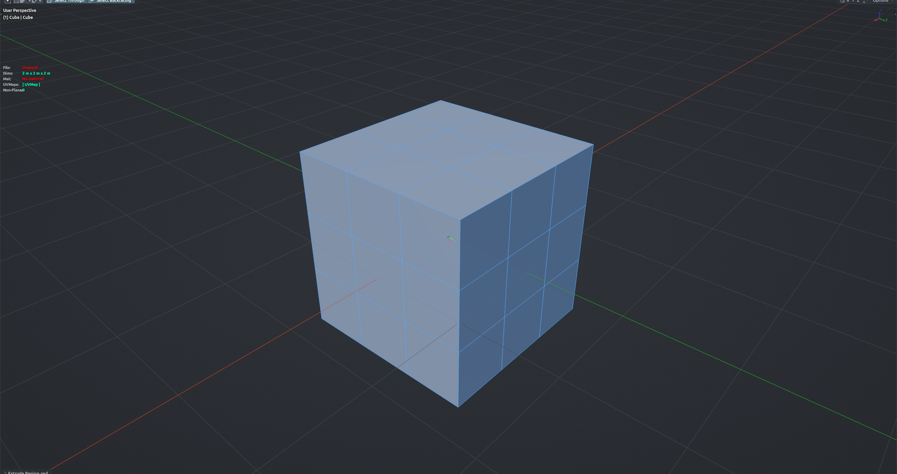

# Non-Planar Faces Overlay

Toggles a live overlay that tints every non-planar face of the mesh you are editing. The stronger the warp, the stronger the tint; flatten a face and its highlight disappears. A **Non-Planar** count appears in the iOps statistics overlay (red while faces need fixing, green at zero). The overlay sticks across object and mode switches until you toggle it off. Edit Mesh mode.

**Hotkey:** Not bound by default — assign a key in *Preferences › iOps › Keymaps*, or run it from the iOps pie / operator search. Also available: iOps Edit Pie › Non-Planar Overlay, iOps Pie › Non-Planar Overlay.

**Shift-click** the button (or the operator) to select the non-planar faces instead of toggling the overlay. It works with the overlay on or off, deselects everything else in every object being edited and switches to face select mode; one undo step reverts it. The selection is computed on the mesh without modifiers, while the overlay shows the mesh with them, so the two can differ when a modifier changes the faces.

## Options
- **Non-Planar Angle** (Preferences › iOps › Non-Planar Overlay) — faces bent less than this count as planar (default 0.5°).

## Tips
- Only the active object is checked; hidden faces and triangles are ignored.
