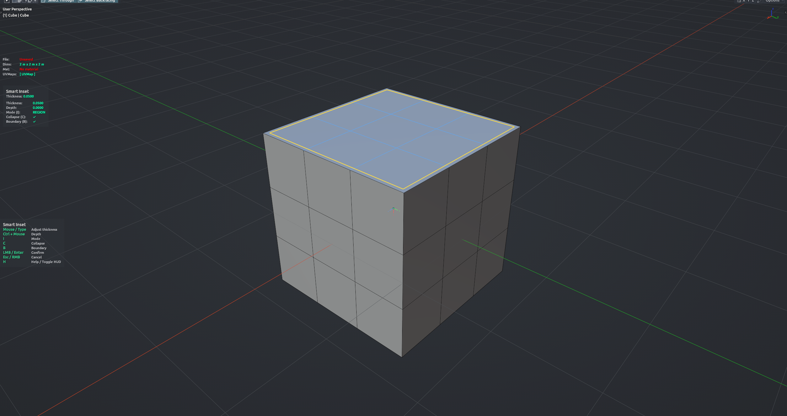

# Smart Inset

Insets the selected faces without the flipped or overlapping geometry the regular inset produces when pushed too far. Every boundary edge moves inward at the same speed; where opposite sides meet, the region cleanly collapses into a ridge or a point instead of self-intersecting. Drag for thickness, hold Ctrl for depth, or type exact values. Edit Mesh mode.

**Hotkey:** Not bound by default — assign a key in *Preferences › iOps › Keymaps*, or run it from the iOps pie / operator search. Also available: iOps Pie › Smart Inset.

## Controls
| Key | Action |
| --- | --- |
| Move mouse | Set thickness |
| <kbd>Shift</kbd> | Precise (slow) adjustment |
| <kbd>Ctrl</kbd> + move | Set depth instead of thickness |
| <kbd>0</kbd>–<kbd>9</kbd>, <kbd>.</kbd>, <kbd>-</kbd>, <kbd>Backspace</kbd> | Type an exact thickness |
| <kbd>I</kbd> | Region / Individual faces |
| <kbd>C</kbd> | Allow collapse on / off |
| <kbd>B</kbd> | Inset from open borders on / off |
| <kbd>U</kbd> | UV Stripe on / off |
| <kbd>MMB</kbd> / <kbd>Wheel</kbd> | Navigate the viewport |
| <kbd>H</kbd> | Show / hide the help legend |
| <kbd>LMB</kbd> / <kbd>Enter</kbd> | Confirm |
| <kbd>Esc</kbd> / <kbd>RMB</kbd> | Cancel |

## Options
- **Thickness** — inward offset; negative values outset.
- **Depth** — push the new inner faces along the normal.
- **Mode** — one inset per connected group of faces (Region) or one per face (Individual).
- **Allow Collapse** — let the inset run past the point where sides meet. Off keeps it clamped like a normal inset; the preview turns to the warning colour when clamped.
- **Boundary** — also inset from open mesh borders.
- **UV Stripe** — unwrap the new walls between the original boundary and the new contour as one straight, even strip per boundary loop in the active UV map (a UV map is created when the mesh has none); for a negative thickness the new outer ring is unwrapped. U runs along the loop and V across it, from the original boundary (V = 0) to the new contour, at one shared scale; the triangles where the inset collapsed are straightened into the strip, and each loop is cut open at its sharpest corner. A region with a hole gives one strip for its outer loop and one for the hole. Off by default.
- **UV Stripe Mode** — *Fit 0–1* stretches each strip across U 0–1 with V in proportion, and stacks several strips (several loops, regions or faces) upward in V with a small gap. *In Place* puts each strip back where its own faces' old UVs were, scaled to the texel density of the faces around it; a strip whose surrounding faces have no UVs fits 0–1 instead. Set in the redo panel.
- **Layout** — with UV Stripe on, how the strip's rows are laid out. *No Stretch* (default) keeps every row at its true length, so a flat piece between straight rails comes out at its true shape with its ends at their real slant; together with Split at Bends a bent strip becomes pieces without any stretch. A closed loop laid out whole cannot close at true lengths and uses Even Rows. *Rectangles* stands every cross edge vertical, so each quad becomes a rectangle; it stretches where the strip bends. *Even Rows* lays each row out by its own length, scaled to the strip's mean length. Set in the redo panel.
- **Orientation** — with UV Stripe on, *Horizontal* (default) runs the strip along U; *Vertical* turns the result 90° counter-clockwise, never mirrored: Fit spans V 0–1 and stacks strips to the right, In Place turns each strip about its own place. Set in the redo panel.
- **Split at Bends** — with UV Stripe on, tear the strip into several UV pieces at the cross edges where it turns within its own surface by more than Bend Angle. A strip that only folds across its cross edges (wrapping a cylinder) is not torn. The pieces of one strip share one texel density. When a tear cannot be made the strip stays whole and a warning says why. On by default. Set in the redo panel.
- **Bend Angle** — the turn that triggers a tear for Split at Bends (15° by default); a gradual arc is torn each time the accumulated turn passes the angle. Set in the redo panel.
- **Mark Seams** — with UV Stripe on, make the seams match the laid-out UV pieces: the outline of every piece (its tears, and where a loop is cut open) is marked, and seams inside a piece are cleared, since the strip was laid out across them. Seams elsewhere are not touched. On by default. Set in the redo panel.

## Tips
- Interior faces the inset has not reached yet are kept as they are.
- The new inner faces stay selected so you can chain another operation right away.
- Selections that wrap around more than half a turn (most of a cylinder) are skipped with a warning.
