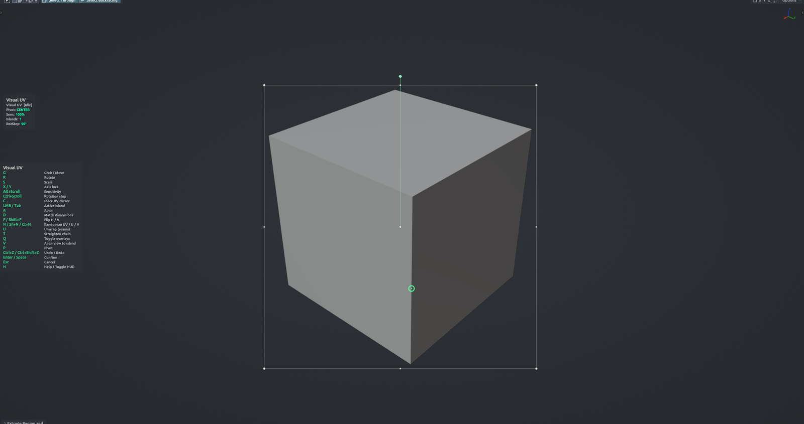

# Visual UV

Edit UV islands directly on the model in the 3D Viewport. The session starts with the islands on the selected faces; click any other visible island to work on it instead, or Shift-click to add or remove islands, just like face selection. Selected islands are colour-coded and the active one shows a bounding box with handles, a pivot and a rotation knob; grab, rotate, scale, flip, align, randomise or unwrap them without opening the UV Editor. Edit Mesh mode with faces selected.

**Hotkey:** <kbd>Ctrl</kbd>+<kbd>Alt</kbd>+<kbd>U</kbd> (Edit Mesh). Also available: iOps Edit Pie › Visual UV.

## Controls
| Key | Action |
| --- | --- |
| <kbd>LMB</kbd> on an island | Select only that island and make it active (any visible island of the mesh, selected or not) |
| <kbd>Shift</kbd>+<kbd>LMB</kbd> on an island | Add it to the selection and make it active, or remove it when it is already selected |
| <kbd>LMB</kbd> / <kbd>Shift</kbd>+<kbd>LMB</kbd> on an edge of a selected island | Select the edge / add it to the edge selection; the island selection stays as it is |
| <kbd>Z</kbd> | Deselect all islands (the tool keeps running) |
| <kbd>LMB</kbd> on a handle / knob | Scale / rotate by dragging the handle |
| <kbd>W</kbd> | Cycle the active island |
| <kbd>Tab</kbd> | Show / hide More Options in the HUD |
| <kbd>G</kbd> / <kbd>R</kbd> / <kbd>S</kbd> | Grab / Rotate / Scale around the pivot (hover a handle to use it as the pivot) |
| <kbd>X</kbd> / <kbd>Y</kbd> | Lock an axis while transforming |
| <kbd>Shift</kbd> | Constrain to the dominant axis (grab) / uniform scale |
| <kbd>Ctrl</kbd> | Snap: 1/16 UV steps, rotation step, 0.05 scale |
| <kbd>Ctrl</kbd>+<kbd>Wheel</kbd> | Change the rotation snap step (1…90°) |
| <kbd>Alt</kbd>+<kbd>Wheel</kbd> | Mouse sensitivity |
| <kbd>C</kbd> / <kbd>P</kbd> | Snap the UV cursor to the active island's nearest bounding-box anchor (corner, side midpoint or centre) and pivot on it / toggle pivot Center ↔ Cursor |
| <kbd>A</kbd> | Align selected islands to the active one's hovered handle, or pick an edge to align to |
| <kbd>I</kbd> | Transform scope: All islands ↔ Active only (affects G / R / S / F / N) |
| <kbd>F</kbd> / <kbd>Shift</kbd>+<kbd>F</kbd> | Flip horizontal / vertical |
| <kbd>D</kbd> / <kbd>Shift</kbd>+<kbd>D</kbd> / <kbd>Ctrl</kbd>+<kbd>D</kbd> | Fit selected islands onto the active one: islands transposed against it (landscape vs portrait) are turned 90° first, then their bounding box is scaled to the active island's box (both axes / width only / height only) and centred on it |
| <kbd>N</kbd> / <kbd>Shift</kbd>+<kbd>N</kbd> / <kbd>Ctrl</kbd>+<kbd>N</kbd> | Randomise offset: both axes / U only / V only, anywhere within the Randomize Range set in the add-on preferences (2 tiles from the UV origin by default) |
| <kbd>U</kbd> / <kbd>Ctrl</kbd>+<kbd>U</kbd> | Unwrap the active island / all selected islands |
| <kbd>Shift</kbd>+<kbd>U</kbd> / <kbd>Shift</kbd>+<kbd>M</kbd> | Cycle the unwrap method / toggle Keep Mirror |
| <kbd>T</kbd> | Straighten the UV edge chain under the cursor |
| <kbd>E</kbd> | Stitch: click a source edge, then move the mouse; the island is scaled, rotated and moved live onto the nearest edge of any other UV island (selected or not). <kbd>LMB</kbd> confirms, <kbd>RMB</kbd> cancels, hold <kbd>Shift</kbd> to land on the same side (overlap) |
| <kbd>Q</kbd> | Clean view: hide overlays |
| <kbd>Ctrl</kbd>+<kbd>Z</kbd> / <kbd>Ctrl</kbd>+<kbd>Shift</kbd>+<kbd>Z</kbd> | Undo / redo inside the session |
| <kbd>RMB</kbd> | Cancel the current transform |
| <kbd>MMB</kbd> / <kbd>Wheel</kbd> | Navigate the viewport |
| <kbd>H</kbd> | Show / hide the help legend (every key of the tool, collapsed at the start) |
| <kbd>Enter</kbd> / <kbd>Space</kbd> | Confirm |
| <kbd>Esc</kbd> | Cancel and restore the original UVs and face selection |

## HUD
The HUD always shows Pivot (P), Scope (I) and the island count; Axis Lock (X / Y) appears during a move or scale and Modifiers Paused (Shift + Q) while the modifiers are paused. <kbd>Tab</kbd> adds UV Map, Sensitivity (Alt + Wheel), Rotation Step (Ctrl + Wheel), Unwrap Method (Shift + U) and Keep Mirror (Shift + M); with Tab off a row still appears while its value is away from its default. Every key works whether its row is shown or not; the help (<kbd>H</kbd>) lists them all.

## Options
- **Tile Limit** — how many tiles an island may drift from 0–1 before it is re-centred.
- **Rotation Step** — snap step for Ctrl-rotate.
- **Grab Sensitivity** — mouse-to-UV multiplier.

## Tips
- Each island shows its texel density next to its centre.
