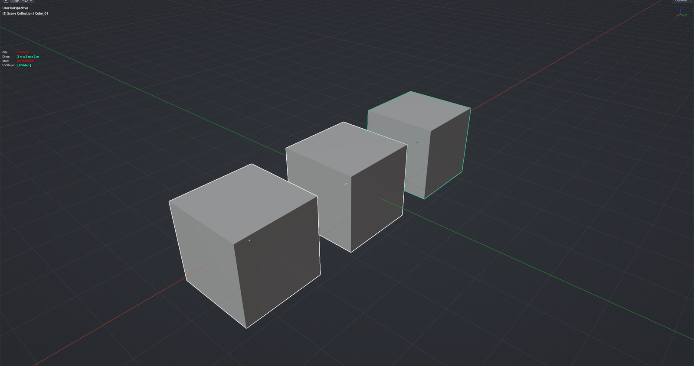

# Name from Active

Renames the selected objects after the active object using a simple pattern with a counter, so a set of fence segments, lamp posts or modular pieces gets clean, sequential names. By default the numbering follows distance from the active object. With a single object selected it instead copies the name to the clipboard and can sync the mesh data name. Object Mode.

**Hotkey:** Not bound by default — assign a key in *Preferences › iOps › Keymaps*, or run it from the iOps pie / operator search. Also available: the *IOPS TPS* sidebar panel (text icon).

## Options
- **New Name** — the base name; filled in from the active object.
- **Pattern** — how the name is built: `[N]` name, `[C]` counter, `[T]` object type, `[COL]` collection name. Default `[N]_[C]`.
- **Use Distance** — number objects by their distance from the active object instead of selection order.
- **Counter Digits / Shift Counter** — zero padding width, and start counting at 1 instead of 0.
- **Rename Active / Rename Linked / Rename Mesh Data** — include the active object, include its children, and rename the mesh data to match.
- **Trim** — strip a number of characters from the start or end of the active name before using it.

## Shift: Search & Replace
Hold **Shift** when calling the operator (key or the text icon in the panel) to open a Search & Replace dialog instead, modelled on Total Commander's Multi-Rename Tool. It renames the selected objects, or the active one when nothing is selected; the bottom of the dialog previews old → new names. Also available directly as `iops.object_search_rename`.

- **Search for / Replace with** — the drop-downs keep this session's earlier entries. `|` separates several terms: `ä|ö|ü` → `ae|oe|ue` replaces each with its pair, a single replacement is used for all. `*` and `?` are wildcards.
- **^** — case-sensitive search (off: case is ignored).
- **1x** — replace only the first occurrence.
- **[E]** — also search the `.001` duplicate suffix; off, the suffix is left as it is.
- **RegEx** — *Search for* is a regular expression; `$1`..`$9` in *Replace with* insert its groups (`$0` the whole match).
- **Subst.** — RegEx only: when the pattern matches, the whole name becomes *Replace with*.
- **Upper/lowercase** — Unchanged, lowercase, UPPERCASE, First letter uppercase, First Letter Of Each Word Uppercase; applied after the replace.

Names swapped inside the selection (`Left|Right` → `Right|Left`) don't collide. A name already used by another object gets Blender's `.001` suffix and the report says how many did.

## Tips
- Select the targets first, then Shift-click the anchor so it becomes active.
- An empty pattern renames nothing.
