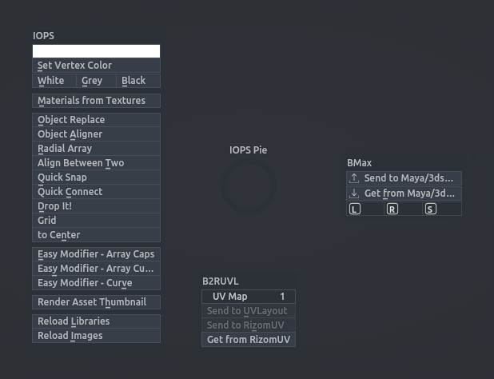
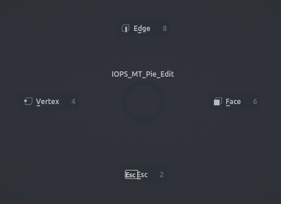
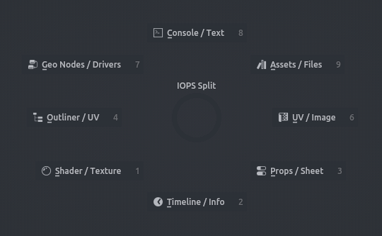
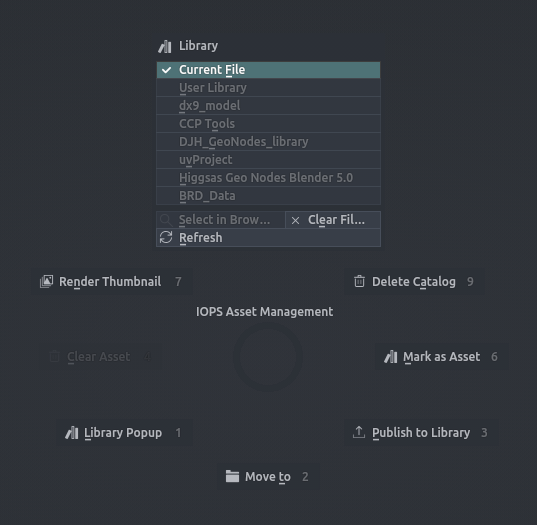
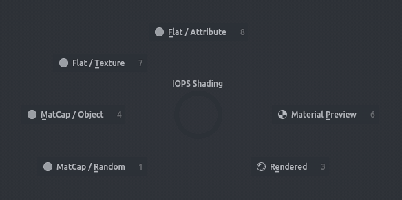

# Pie Menus

InteractionOps adds a set of pie menus and one floating library palette. Every pie has its own hotkey (see *Preferences › iOps › Keymaps*); buttons that cannot run in the current context are hidden, so a pie only shows what works right now.

---

## Main Pie

The everyday toolbox of iOps operators, sorted into titled group boxes. Object Mode and Edit Mesh get different groups; every other mode uses the Object Mode set. Buttons that cannot run right now are hidden, and a group with nothing left to show is dropped. Third-party addon tools live in the [External Pie](#external-pie).

**Hotkey:** <kbd>Ctrl</kbd>+<kbd>Alt</kbd>+<kbd>Shift</kbd>+<kbd>Q</kbd>

### Object Mode

| Slot | Box | Buttons |
| --- | --- | --- |
| Left | **Transform & Align** | Object Aligner, Align Between Two, 3 Point Rotation, Mirror Rotate, Match Dimensions, Normalize, Change Scale, Visual Origin, Drop It! |
| Right | **Arrange** | Object Replace, Radial Array, Grid / Grid to Center, To Grid From Active |
| Bottom | **Vertex Color** | See below |
| Top | **Select & Name** | Select Similar Name, Name From Active, Search & Replace, Select Boolean Operands, Select Boolean Targets, Select Mirror Objects |
| Top-left | **Modifiers** | Easy Modifier shortcuts: Array Caps, Array Curve, Curve, SHWARP |
| Top-right | **Assets & Files** | Materials from Textures, Material Override, Render Asset Thumbnail, Reload Libraries, Reload Images |
| Top, rightmost column | **Overlays** | Negative Scale Overlay, Z-Fight Overlay, Hidden Faces Overlay with its Rays field (each drawn pressed while its overlay is on; Shift-click Z-Fight or Hidden Faces to select the faces) |

### Edit Mesh

| Slot | Box | Buttons |
| --- | --- | --- |
| Left | **Mesh** | Inset, Edge Slide, Straight Bevel, Shear, Hinge, Converge, Vert Fuse, Quick Connect, Quick Snap, Tris to Quads, Cursor Bisect, To Grid, Mesh Snapshot |
| Right | **UV** | UV Stripe (Interactive), UV Pipe, UV Shortest Path Mark, UV Channel Hop, Visual UV |
| Bottom | **Vertex Color** | See below |
| Top | **Measure & Align** | Copy Edge Length, Copy Edges Angle, Align Origin to Normal, Align Object to Face |
| Top-left | **Bevel** | Pin & Unwrap Bevel, Bevel Edge Data Fix |
| Top, rightmost column | **Overlays** | Non-Planar Overlay, Z-Fight Overlay, Hidden Faces Overlay with its Rays field (each drawn pressed while its overlay is on; Shift-click Non-Planar, Z-Fight or Hidden Faces to select the faces) |

### Vertex Color box

The bottom slot in both modes. Colour picker + **Set Vertex Color**, **White / Grey / Black**, **Set Vertex Alpha**; then the vertex paint brush: **Paint**, a row of palette swatches that start the brush with that colour, and **Blur / Sharpen** for the existing vertex colours. The brush buttons are the same as in the sidebar *IOPS Vertex Color* panel.

---

## External Pie

Tools of companion addons, one box per addon. A box appears only when its addon is installed; with none installed the pie shows *No external addons installed*.

**Hotkey:** <kbd>Ctrl</kbd>+<kbd>&#96;</kbd> (the key left of 1)

| Slot | Box | Buttons |
| --- | --- | --- |
| Left | **BMax** | Send to / Get from Maya/3dsmax (FBX or USD, per the addon's file format), Reset Location / Rotation / Scale toggles |
| Right | **BMoI** | Send to / Get from MoI3D |
| Bottom | **B2RUVL** | UV map choice, Send to UVLayout, Send to RizomUV, Get from RizomUV |
| Top | **ForgottenTools** | Connect Spread, Grid Fill All, Dice Faces, Hinge, Separate Duplicate, Selection Sets (Edit Mesh) |
| Top-right | **Optiloops** | Optiloops (Edit Mesh) |

---

## Edit Pie

A context pie that mirrors the F1–F5 dispatcher: the four cardinal buttons are the current F1 / F2 / F3 / Esc actions for the active object type and mode, with a box of the object's most-used settings next to them in Object Mode.

**Hotkey:** Not bound by default — assign a key to *IOPS Pie Edit* in *Preferences › iOps › Keymaps*.

| Object | Mode | F1 | F2 | F3 | Esc |
| --- | --- | --- | --- | --- | --- |
| Mesh | any | Vertex | Edge | Face | Esc |
| Armature | Object | Edit Mode | Pose Mode | Set Parent to Bone | Esc |
| Armature | Edit / Pose | Object Mode / Edit Mode | Pose / Object Mode | Set Parent to Bone | Object Mode |
| Empty | any | Open Instance Collection .blend | Realize Instances | — | Esc |
| Curve | Object | Edit Mode | Duplicate | Switch Direction | Toggle Cyclic |
| Curve | Edit | Object Mode | Subdivide | Spline Type | Esc |
| Curves (hair) | Object / Edit / Sculpt | Edit Mode / Object Mode | Duplicate / Subdivide | Cyclic / Sculpt Toggle | Esc |
| Camera | any | Active Camera | Camera View | Cam to View | Toggle DOF |
| Light | any | Duplicate | Toggle Shadow | Boost Power | Cycle Type |
| Text | Object / Edit | Edit Mode / Object Mode | Convert to Mesh / Duplicate | To Curve / Bold | Esc |
| Lattice | Object / Edit | Edit Mode / Object Mode | Duplicate | — / Flip U | Esc |
| Metaball | Object / Edit | Edit Mode / Object Mode | Duplicate | — / Threshold - | Finer Preview / Esc |
| Light Probe | any | Duplicate | + Influence | - Influence | Hide Viewport |

Extras:

| Context | Button | What it does |
| --- | --- | --- |
| Empty | **Size** box: 0.1 / 0.5 / 1 / 2 / 5 / 10, custom slider, **Copy from Active** | Set the display size of the selected empties |
| Empty | **Display** box: Plain Axes, Arrows, Single Arrow, Circle, Cube, Sphere, Cone, Image | Change the empty's display type; image empties get **Reload Image** and **Origin to Geometry** |
| Collection instance | **Make Instances Real**, **Expand Collection to Scene**, **Select Source Collection** (SW), **Select All Instances** (SE), **Open <file>**, **Reload <file>** | Work with the instanced collection; **Make Instances Real** has an **Only Type** dropdown in the redo panel: All keeps everything, any other type (Mesh, Curve, Text, Empty, Light, Camera, Armature) keeps just those objects and deletes the rest, instancer empties included, with the kept objects staying put in world space; both select buttons are toggles: **Select Source Collection** flips back to the collection the instance itself lives in, **Select All Instances** selects every visible instance of the same collection and, pressed again, deselects the others; **Select Source Collection** makes the instanced collection active in the Outliner, expands the tree down to it and scrolls there (when it lives in the current scene); object selection stays as is |
| Collection instance | **Edit Instance** (NW; collection icon for a local collection, chain icon for a linked one) | Edit the instanced collection in place; see [Edit Instance](../operators/op_instance_edit.md). While a session is open the slot swaps, like the header, to **Stop** + **Restore** (local session) or **Commit** + **Cancel** (linked session) |
| Collection instance (linked collection) | N column: **Open <file>** (new Blender), **Reload <file>**, **Open in Current Blender** (when available); **Expand Collection to Scene** sits NE | File actions for the linked source; Commit of an edited linked collection is described under [Linked collections](../operators/op_instance_edit.md#linked-collections) |
| Mesh, Edit Mode | **Visual UV** | Show UVs on the mesh in the viewport |
| UV Editor | Vertex / Edge / Face / Esc + **Island Selection** | UV select modes and island toggle |
| No active object | **Open Asset in Current Blender** | When an asset is selected in the Asset Browser |

---

## Split Pie

Open or close a second editor next to the current one with a flick. Each of the eight slots is yours to configure in *Preferences › iOps › Split Pie Layout*: primary editor, alternate editor, side and split size.

**Hotkey:** <kbd>Ctrl</kbd>+<kbd>Alt</kbd>+<kbd>Shift</kbd>+<kbd>S</kbd>

| Slot | Default editor |
| --- | --- |
| Left | Outliner |
| Right | UV Editor |
| Bottom | Timeline |
| Top | Python Console |
| Top-left | File Browser |
| Top-right | Text Editor |
| Bottom-left | Shader Editor |
| Bottom-right | Properties |

| Click | What it does |
| --- | --- |
| Click | Open the slot's editor on its side; click again to close it |
| <kbd>Shift</kbd>+Click | Open the slot's alternate editor |
| <kbd>Alt</kbd>+Click | Switch the current area to that editor in place (no split) |
| <kbd>Ctrl</kbd>+Click | Turn the current area back into a 3D Viewport |

---

## Assets Pie

Asset Browser housekeeping without leaving the viewport: mark and clear assets, move them between catalogs, switch libraries and publish to the iOps Library.

**Hotkey:** <kbd>Ctrl</kbd>+<kbd>Alt</kbd>+<kbd>Shift</kbd>+<kbd>A</kbd>

| Slot | Button | What it does |
| --- | --- | --- |
| Left | **Clear Asset** | Un-mark the selected assets |
| Right | **Mark as Asset ›** Object / Collection / Active Material / Active Image | Mark the chosen datablock as an asset |
| Bottom | **Move to ›** | Catalog tree of the current library; **Search**, **New Catalog** |
| Top | **Library** box | Pick *Current File* or any asset library, **Select in Browser**, **Clear Filter**, **Refresh**, **Open Asset in Current Blender** |
| Top-left | **Render Thumbnail** | Render a preview image for the active asset |
| Top-right | **Delete Catalog ›** | Catalog tree with **Search** and **Delete Empty Catalogs** |
| Bottom-left | **Library Popup** | Open the iOps Library palette (below) |
| Bottom-right | **Publish to Library ›** Active Object / Active Collection / Active Material / Shader Group / Geometry Nodes | Publish to the iOps master library |

---

## Shading Pie

Up to eight viewport shading presets, one per slot: Solid with a lighting and colour mode, Material Preview or Rendered with a render pass, optional scene world. Configure names and contents in *Preferences › iOps › Shading Pie*; empty slots are left blank.

**Hotkey:** No default key — assign one to *IOPS Pie Shading* in *Preferences › iOps › Keymaps*.

| Slot | What it does |
| --- | --- |
| Any enabled slot | Apply that shading preset to the current 3D Viewport |

Slot labels are generated from the preset (for example *Studio / Random* or *Rendered / AO*) unless you give the slot a name.

---

## Snap Combos Pie

The eight [Snap Combo](../operators/op_snap_combos.md) slots as a pie. Click a slot to recall its snap settings; click with the save modifier (*Preferences › iOps › Snap Combo*, Shift by default) to store the current settings in that slot.

**Hotkey:** No default key — assign one to *IOPS Pie Snap Combos* in *Preferences › iOps › Keymaps*.

| Slot | Button | Snap Combo |
| --- | --- | --- |
| Left | **C - Cursor** | 3 |
| Right | **E - Median** | 5 |
| Bottom | **A - Active** | 1 |
| Top | **H - Individual** | 8 |
| Top-left | **G - Grid** | 7 |
| Top-right | **B - Closest** | 2 |
| Bottom-left | **F - Face Normal** | 6 |
| Bottom-right | **D - Center** | 4 |

---

## Library Popup

A floating palette drawn over the 3D View that shows the assets of your iOps master library as thumbnails, grouped by category. Click a tile to insert that asset at the 3D cursor. The viewport stays fully usable around the palette.

**Hotkey:** <kbd>Ctrl</kbd>+<kbd>Alt</kbd>+<kbd>Q</kbd> (3D View). Also available: Assets Pie › *Library Popup*, Library panel › *Open Library Popup*.

| Control | What it does |
| --- | --- |
| Asset tile | Insert the asset into the scene |
| Tile **x** | Remove that asset from the library |
| Category header (Geometry, Materials & Shaders, Lights & Worlds, Misc) | Collapse / expand the group |
| **Publish:** Obj / Col / Mat / Node | Publish the active object, collection, material or node group |
| **-** / **Size** / **+** | Shrink or enlarge the thumbnails |
| **Refresh** | Re-sync the library |
| **X** | Close the palette |
| Drag the title bar | Move the palette |
| Wheel | Scroll the asset list |
| <kbd>Esc</kbd> / <kbd>RMB</kbd> over the palette | Close |
